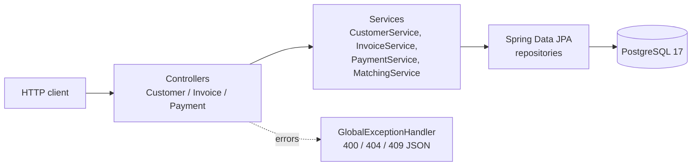
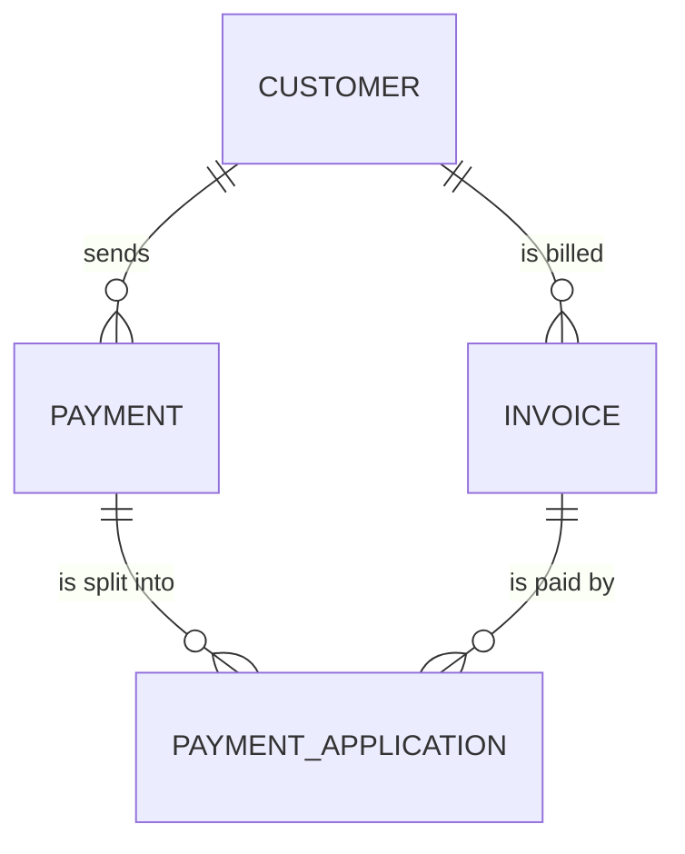

# cashapp: payment-to-invoice matching service

A Spring Boot REST service that does **cash application**: when a customer's payment arrives,
decide which open invoices it pays, record the audit trail, and keep any leftover money as a
credit on the customer's account.

In accounts receivable this is a daily, high-volume job. Customers pay several invoices with one
transfer, pay part of an invoice, overpay, or write invoice numbers in the remittance note
(or don't). This service automates the matching with three explainable rules.

**Stack:** Java 17 · Spring Boot 3.5 · Spring Data JPA / Hibernate · PostgreSQL 17 · Bean Validation · JUnit 5 · Mockito · MockMvc · H2 (tests) · Docker Compose · Maven wrapper

## Architecture



* **Controllers** only receive HTTP requests, validate the body (`@Valid`) and call a service.
* **Services** hold the business logic and convert entities to response records (DTOs), so
  database entities never leak into the API.
* **Repositories** are interfaces; Spring Data generates the SQL from method names.
* **GlobalExceptionHandler** turns exceptions into one consistent JSON error shape.

## Data model



| Entity | Key fields |
|---|---|
| `Customer` | name, email |
| `Invoice` | invoiceNumber (unique), totalAmount, **openAmount**, dueDate, status `OPEN / PARTIALLY_PAID / PAID` |
| `Payment` | amount, **unappliedAmount**, paymentDate, referenceText (remittance note), status `UNMATCHED / PARTIALLY_APPLIED / FULLY_APPLIED` |
| `PaymentApplication` | payment, invoice, amountApplied, matchRule, appliedAt. This is the audit trail of where each rupee went. |

Money is always `BigDecimal` (never `double`, which can't store 0.10 exactly) and compared with `compareTo`.

## Matching rules

`POST /payments/{id}/match` runs these in order, **only against the same customer's unpaid invoices**:

1. **Reference match**: invoice numbers found in the payment's `referenceText` are paid first, in the order they are written (case-insensitive).
2. **Exact amount**: if rule 1 applied nothing and **exactly one** open invoice owes exactly the payment amount, pay that one. If two invoices have the same amount, it's ambiguous, so skip to rule 3.
3. **Oldest first**: whatever is left pays invoices by earliest due date.

Each piece creates a `PaymentApplication` and updates both sides' balances and statuses in one
`@Transactional` method (all or nothing). Money left over stays as `unappliedAmount`
(a credit on account). Matching a fully applied payment again returns **409 Conflict**.

## Run it

Prerequisites: JDK 17 and Docker Desktop. Maven is not needed; the wrapper downloads it.

```powershell
docker compose up -d            # PostgreSQL 17 on localhost:5434 (db/user/password: cashapp)
.\mvnw.cmd spring-boot:run      # API on http://localhost:8080
```

In a second terminal, run the scripted end-to-end demo:

```powershell
.\demo.ps1
```

## Tests

```powershell
.\mvnw.cmd test
```

Tests use an in-memory H2 database, so Docker is not needed. There are 14 tests:

* `MatchingServiceTest`: 9 unit tests with Mockito mocks (exact amount, reference order, partial payment, overpayment, oldest-first, ambiguous amount, other customer's invoices ignored, already-applied payment, missing payment).
* `InvoiceControllerTest`: `@WebMvcTest` for validation errors (400 with field errors) and 404.
* `MatchingFlowIntegrationTest`: the whole app over HTTP (MockMvc) with real JPA queries, plus duplicate invoice number (409).

## API

| Method | Path | What it does |
|---|---|---|
| POST | `/customers` | create a customer |
| GET | `/customers`, `/customers/{id}` | list / get customers |
| POST | `/invoices` | create an invoice |
| GET | `/invoices?customerId=&status=` | search invoices (both filters optional) |
| GET | `/invoices/{id}` | get an invoice |
| POST | `/payments` | record a payment (not matched yet) |
| GET | `/payments/{id}` | get a payment and its applications |
| POST | `/payments/{id}/match` | run the matching rules |
| GET | `/health` | liveness check |

Example:

```powershell
Invoke-RestMethod -Method Post http://localhost:8080/payments -ContentType application/json `
  -Body '{"customerId":1,"amount":3000.00,"paymentDate":"2026-03-01","referenceText":"Payment for INV-B"}'

Invoke-RestMethod -Method Post http://localhost:8080/payments/1/match
```

```json
{
  "paymentId": 1,
  "applications": [
    { "invoiceNumber": "INV-B", "amountApplied": 2500.00, "matchRule": "REFERENCE_MATCH" },
    { "invoiceNumber": "INV-A", "amountApplied": 500.00,  "matchRule": "OLDEST_FIRST" }
  ],
  "unappliedAmount": 0.00,
  "paymentStatus": "FULLY_APPLIED"
}
```

Validation error example (`POST /invoices` with an empty body):

```json
{
  "status": 400,
  "error": "Bad Request",
  "message": "Request validation failed",
  "fieldErrors": { "invoiceNumber": "invoiceNumber is required", "totalAmount": "totalAmount is required" }
}
```

## Possible next steps

* Flyway migrations instead of `ddl-auto=update`
* Fuzzy reference matching (typos such as `INV1001` vs `INV-1001`)
* Bulk import of bank statement files (CSV / MT940) and batch matching
* Un-apply / reverse an application, with an audit log
* Optimistic locking (`@Version`) so two matches can't spend the same payment at once
